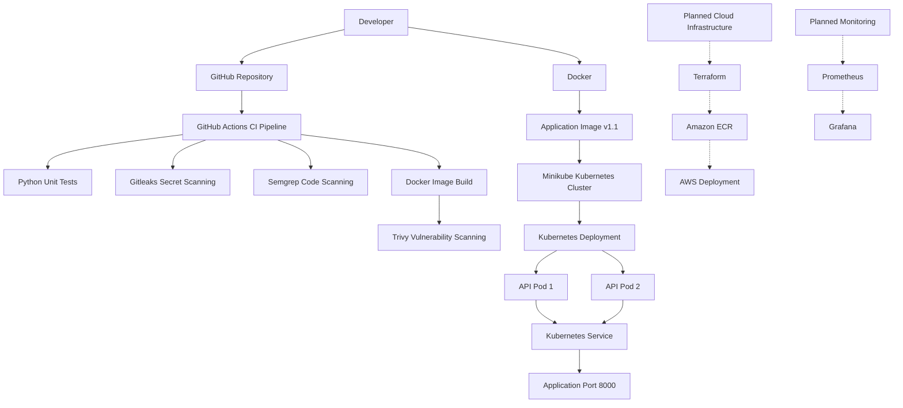

# Enterprise Platform Engineering

## Project Overview

Enterprise Platform Engineering is a hands-on project focused on building
secure, automated, and reliable application delivery workflows.

The project demonstrates containerization, automated testing, security
scanning, and local Kubernetes deployment. Future phases will expand the
platform with Infrastructure as Code, AWS integration, and monitoring.

## Architecture

The current application delivery workflow is:

1. Develop a Python API.
2. Run automated unit tests.
3. Build a Docker image.
4. Scan for exposed secrets using Gitleaks.
5. Scan source code using Semgrep.
6. Build and scan the Docker image using Trivy.
7. Deploy the container to a local Kubernetes cluster using Minikube.
8. Expose the application through a Kubernetes Service.

GitHub Actions automatically runs the configured CI workflow on pushes
to `main` and pull requests targeting `main`.

## Technology Stack

### Implemented and Tested

- **Python:** Application API and automated unit tests.
- **Docker:** Container packaging and health checks.
- **Kubernetes:** Local application deployment and replica management.
- **Minikube:** Local Kubernetes cluster.
- **kubectl:** Kubernetes command-line management.
- **GitHub Actions:** Automated CI workflow.
- **Gitleaks:** Secret scanning.
- **Semgrep:** Source-code security scanning.
- **Trivy:** Container image vulnerability scanning.
- **Git and GitHub:** Source control and project hosting.

### Planned

- **AWS:** EC2, ECR, IAM, Systems Manager, VPC, and S3.
- **Terraform:** Reusable infrastructure modules.
- **Jenkins:** Additional CI/CD automation.
- **Prometheus and Grafana:** Monitoring and visualization.
- **Nexus Repository:** Artifact management.

Planned components will be marked as implemented only after they have
been configured and tested.

## Application Endpoints

| Endpoint | Purpose |
|---|---|
| `/` | Returns the API welcome message and available endpoints. |
| `/health` | Returns application health information. |

The application listens on port `8000` inside its container.

## Run Locally

### Run the automated tests

```bash
make test


---

## 🏗️ Enterprise Platform Engineering Architecture

This diagram illustrates the application development, security scanning, containerization, and Kubernetes deployment workflow.



### Architecture Status

- **Implemented:** GitHub, GitHub Actions, Python, Docker, Gitleaks, Semgrep, Trivy, Kubernetes, and Minikube.
- **Planned:** Terraform-managed AWS infrastructure, Amazon ECR, AWS deployment, Prometheus, and Grafana.

The diagram is rendered by GitHub using Mermaid. It updates when the diagram's source is changed; it does not automatically discover live infrastructure changes.

---

## 📐 Architecture Documentation

View the complete architecture diagram, including the CI pipeline, security scanning, Docker, Kubernetes, and planned AWS infrastructure.

**[View the Enterprise Platform Engineering Architecture Diagram](documentation/architecture/architecture-diagram.md)**
