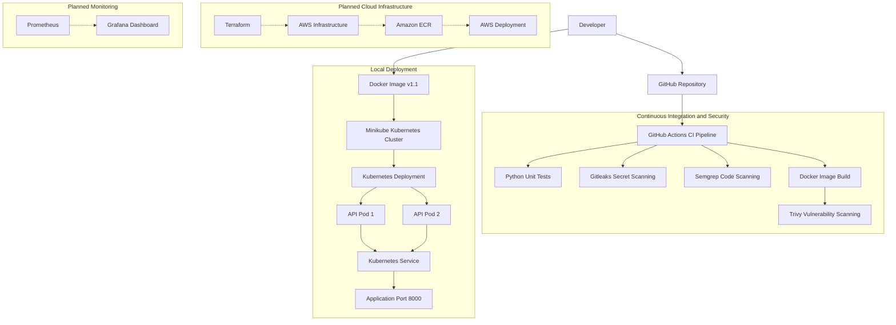

# Enterprise Platform Engineering Architecture

This diagram shows the application's development workflow, security checks, containerization, and Kubernetes deployment.

## Architecture Diagram

## Implemented Tools

- **Git and GitHub:** Source control and code hosting.
- **GitHub Actions:** Automated CI workflow.
- **Python:** Application and unit tests.
- **Gitleaks:** Secret scanning.
- **Semgrep:** Source-code security scanning.
- **Docker:** Container image building.
- **Trivy:** Container vulnerability scanning.
- **Kubernetes and Minikube:** Local container orchestration.

## Planned Tools

- **Terraform:** Infrastructure as code.
- **AWS:** Cloud infrastructure.
- **Amazon ECR:** Container image registry.
- **Prometheus:** Metrics collection.
- **Grafana:** Monitoring dashboards.

## Important Notes

The solid lines show the implemented development and local deployment components. The dashed lines represent planned cloud infrastructure and monitoring work.

The CI workflow runs automated checks, but it does not currently deploy the application automatically to AWS or Minikube.

The Mermaid diagram is rendered by supported Markdown viewers, including GitHub. It is not an automatically updating infrastructure monitoring dashboard.
